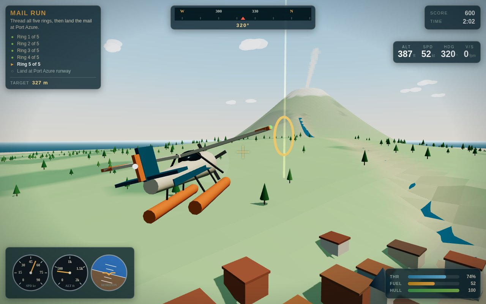

# Harbor Wings — Seaplane Mail & Rescue

An entry for make.fun's **Make the best flight game** bounty
(`best-flight-game-20261126-0057`).



**Harbor Wings** is a 3D floatplane game set in the Azure Archipelago. From
the grass-and-timber strip at Port Azure you fly three working sorties in a
cream-and-teal seaplane:

- **Mail Run** — thread five glowing rings over the bay, Gull Rock
  lighthouse, the Rio Verde valley and the foothills of Mount Kora, then
  land the mail on the Port Azure runway to a judged grade.
- **Harbor Rescue** — a fishing boat is sinking in the bay. Hold the
  seaplane low and slow over her deck to hoist three sailors, watching your
  fuel the whole time, then bring them home.
- **Volcano Survey** — photograph four vents on smoking Mount Kora. The
  updrafts give free lift; the ash eats your engine.

The flight model rewards discipline: banked turns bleed speed, climbs cost
speed, slow flight stalls with a buffet and a dropped nose, fuel burns
faster at full throttle, and every touchdown is graded — PERFECT, SMOOTH,
FIRM, ROUGH or CRASH — on sink rate, speed, surface and alignment. Land on
the strip, or set her down on the harbour water like a seaplane should.

## Controls

| Key | Action |
| --- | --- |
| W / S | Throttle up / down |
| ↑ / ↓ | Pitch |
| ← / → | Bank |
| A / D | Rudder |
| C | Chase / cockpit view |
| R | Restart sortie |

## Layout

- `main.ts` — the hand-in program: copies `game/` and `screenshots/` to the
  output directory and writes `dossier.json` with the vendored make.fun
  library (`vendor/makefun-game.ts`, the kit's copy, unchanged).
- `game/` — the game itself, plain static files, fully offline. three.js is
  vendored at `game/vendor/three.min.js` (MIT, three r186); everything else
  is the game's own source, one job per file under `game/js/`:
  `terrain.js` builds the archipelago from one shared height function,
  `aircraft.js` builds the floatplane, `flight.js` is the flight model,
  `missions.js` runs the three sorties, `hud.js` draws the instrument
  panel, `camera.js` flies the cameras, `sound.js` synthesises every
  sound, `shots.js` stages the screenshot scenes, `main.js` wires it up.
- `screenshots/` — the four judged stills, staged deterministically with
  `game/js/shots.js`.
- `serve.ts` — a tiny local server for playing the game during development.

## Running it

```sh
node serve.ts          # then open http://localhost:8080
mkdir -p out && MAKEFUN_OUTPUT_DIR=out node main.ts   # the hand-in
```

Licence: MIT (see `LICENSE`). three.js is MIT-licensed by its authors.
